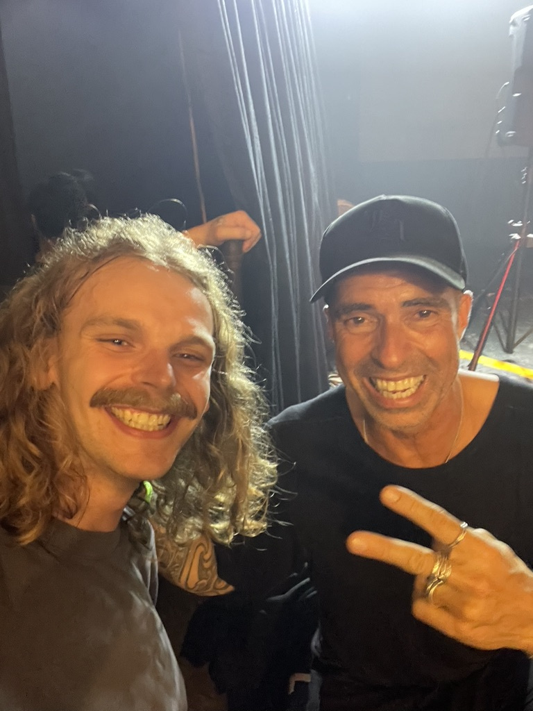
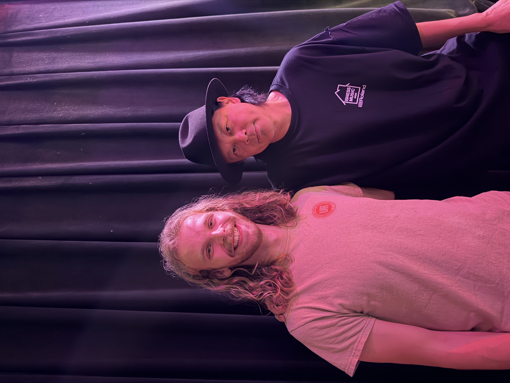

+++
author = "Carson Connard"
title = "Techno"
date = "2025-11-24"
description = "my techno blog"
tags = [
    "shortcodes",
    "privacy",
]
+++

I listen to a lot of techno music, and I am very interested in its history and developement in different scenes around the world. I'll be a volunteer DJ for Rainy Dawg Radio under the moniker 6th Meridian beginning January 2027.
<!--more-->
---

## Commentary

Techno was born in Detroit, out of the emotions and attitudes surrounding deindustrialization, urban decay, anti-corporatism, futurism, and liberation in the Rust Belt of the ’80s and ’90s. To me, it has always been a cathartic expression of sound, a way of turning the weight of a place into something you can move to. As a proud Midwesterner, I feel a strong connection to the music. Over the past decade I’ve followed its story from Detroit to Germany, England, and cities across the U.S., and I’m fascinated by how much its early sound was shaped by Detroit itself. Detroit's industrial relationship with Japan, its place on the Canadian border, and collectives like Underground Resistance who built the genre’s identity in protest to industry norms, and the lasting fixation on physical media help define the genre in my mind. I’ve been lucky to talk with a few people connected to the genre’s beginnings, and those conversations have shaped how I hear the music and the ideas behind it.

<!-- What I love most is the underground sound that defined techno before commercialization took hold of the genre and rave culture as a whole: the raw, unpolished records, the regional styles that branched off from the Detroit tradition, and the nastiest grooves I can dig up. Techno is inherently soulful. It makes you want to move your body, and that physicality is where its power lies. On a dance floor, listeners converge on a single shared energy where emotions are raw and unfiltered and the ego melts away. That convergence, people pulled together by sound born from struggle and imagination, is what I see in techno, and it’s why I keep coming back to it. -->

## Mixes

[Soundcloud upload](https://soundcloud.com/cconn30/back-on-the-decks-techno-112225) -- An "I've neglected my controller since moving to Seattle" improv set, excited to get tighter mixes again.

## Recent favorites

*under construction*

Chris Liebing and I after his 2025 show in Seattle

Ken Ishii and I after his 2026 show in Seattle